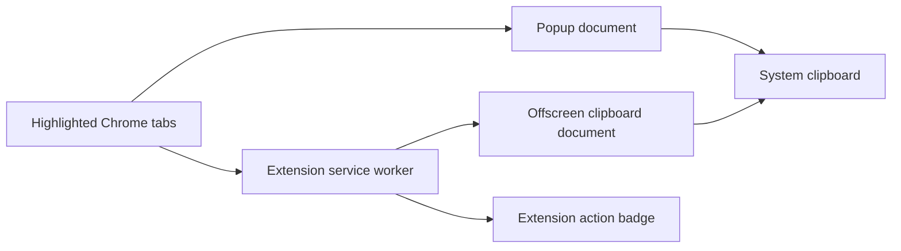

# Copy Selected Tab URLs: Design

Status: Approved

## Context and scope

Chrome lets users highlight multiple tabs with Command/Ctrl-click or
Shift-click, but copying every highlighted tab URL still requires repetitive
work. This extension will provide a small popup for previewing and copying
those URLs, plus a keyboard shortcut for immediate copying.

The project will be published as an independent open-source repository at
`tori-create-7991/copy-selected-tab-urls`.

## Goals

- Read highlighted tabs from the currently relevant Chrome window.
- Preserve tab-strip order.
- Copy one URL per line.
- Support a preview-and-copy popup.
- Support direct copy through a configurable Chrome command.
- Keep all processing local and request only the permissions needed.
- Remain understandable without a build system or runtime dependencies.

## Non-goals

- Markdown or title-and-URL output formats.
- An extension settings page.
- Tab persistence, restoration, or synchronization.
- Firefox support.
- Chrome Web Store submission.
- Analytics, telemetry, or external network requests.

## User experience

### Popup flow

1. The user highlights one or more tabs.
2. The user opens the extension popup.
3. The popup lists the highlighted tabs in tab-strip order.
4. The user selects **Copy URLs**.
5. The popup confirms how many URLs were copied or explains why copying failed.

The currently active tab counts as one highlighted tab, so the same flow works
when only one tab is selected.

### Shortcut flow

1. The user highlights one or more tabs.
2. The user presses the extension command:
   - macOS: `Command+Shift+L`
   - Other platforms: `Ctrl+Shift+L`
3. The extension copies immediately without opening the popup.
4. The extension action badge briefly shows the copied count, `0`, or `!`.

Users can change the key binding at `chrome://extensions/shortcuts`.

## System design

### Components

- `manifest.json` declares Manifest V3, the popup, the service worker, the
  direct-copy command, and `tabs`, `offscreen`, and `clipboardWrite`
  permissions.
- `src/tab-urls.js` contains pure logic for filtering, sorting, and formatting
  tab URLs. Both flows use the same behavior.
- `src/popup.html`, `src/popup.css`, and `src/popup.js` render the preview and
  write to the clipboard in the visible extension document.
- `src/background.js` handles the command, queries the highlighted tabs in the
  command's window, ensures the offscreen document exists, delegates the
  clipboard write, and updates the badge.
- `src/offscreen.html` and `src/offscreen.js` provide DOM clipboard access for
  the service worker flow.

No content script is required.

## Data and error handling

- Sort tabs by their numeric `index` before extracting URLs.
- Include every non-empty URL returned by the Tabs API.
- Ignore tabs whose URL is unavailable.
- Return an empty result when no copyable URL exists.
- The popup displays a text explanation for zero results or clipboard errors.
- The shortcut flow shows `0` for zero results and `!` for errors.
- Badge feedback is cleared after a short timeout.
- No URL or usage data is stored or transmitted.

## Alternatives considered

### Popup only

This needs fewer moving pieces but does not meet the approved direct-copy
shortcut requirement.

### Popup plus direct-copy shortcut

Selected. It supports a safe preview flow and a fast keyboard flow. The cost is
an offscreen document and the associated permission.

### Configurable output formats and settings

Deferred. It would add state, UI, tests, and documentation before the core
workflow has proven useful.

## Risks and mitigations

| Risk | Impact | Mitigation |
|---|---|---|
| A suggested shortcut conflicts with Chrome or the operating system | The default binding may be inactive | Document `chrome://extensions/shortcuts` and expose the command clearly |
| Clipboard APIs differ between visible and service-worker contexts | Direct copy fails | Use the Chrome Offscreen API with the `CLIPBOARD` reason |
| Some tabs do not expose a URL | The copied count differs from the highlighted count | Filter only unavailable URLs and report the copied count |
| UI and background flows drift | Output differs by trigger | Keep ordering and formatting in one pure shared module |

## Success metrics

- `node --test` exits with status 0.
- Tests cover ordering, unavailable URLs, single-tab input, multi-tab input,
  newline formatting, and the manifest command/permission contract.
- Manual verification confirms that popup and shortcut flows copy the same
  highlighted URLs in tab-strip order.
- The extension makes no external network requests.
